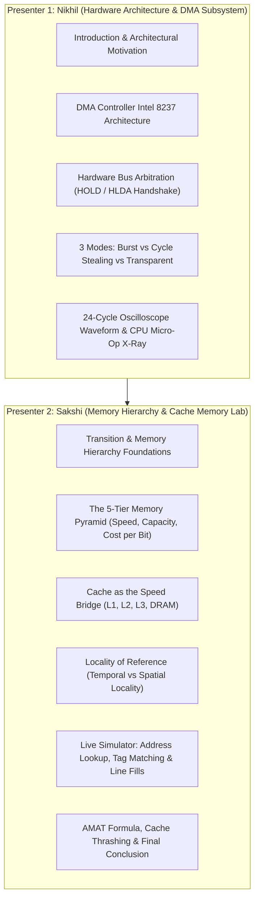

# OS-ArchLab: Two-Member Faculty Presentation & Live Demonstration Guide

---

## 1. Quick-Start: How to Launch & Operate the Simulation

You have two identical, production-ready ways to run the project during your evaluation:

### Option A: High-Performance Single File (`standalone.html`) — Recommended for Viva
* **Location:** Open [`standalone.html`](file:///d:/code/os%20visual/standalone.html) directly in Chrome, Edge, or Firefox.
* **Why it's ideal:** Zero dependencies, runs completely offline without internet or terminal servers, and cannot crash due to network drops.

### Option B: React Vite Development Server
* **Terminal Command:** In your project directory, run `npm run dev`.
* **Access URL:** Open [http://localhost:3000/](http://localhost:3000/) in your browser.

### Key Hotkeys & Presentation Controls
* **`Spacebar` / `Enter`:** Dismiss startup POST boot sequence or start/pause transfer.
* **`ESC`:** Closes the CPU Microarchitecture X-Ray modal or exits Presentation Cinema Mode.
* **`⛶ CINEMA MODE` Button (Top Right):** Expands the simulator to a clean, borderless display with a floating minimalist HUD—perfect for projector screens.

---

## 2. Two-Member Team Division of Roles (50 / 50 Split)

To ensure both presenters receive top evaluation marks, the presentation is divided logically into two balanced halves:

---

## 3. Minute-by-Minute Script with Exact Click Cues

### Part 1: Project Introduction & DMA Deep-Dive (Presenter 1: Nikhil)
*Estimated Duration: ~4 to 5 Minutes*

#### Step 1: Startup POST & Project Introduction
* **Action:** Launch [`standalone.html`](file:///d:/code/os%20visual/standalone.html). Let the cybernetic POST boot sequence play for 2 seconds.
* **Presenter 1 Speaks:**
  > *"Respected faculty, welcome to our presentation on **OS-ArchLab**, an interactive hardware and operating system simulation platform. In modern operating systems, high-throughput I/O and memory hierarchy management are the cornerstones of overall system performance.*
  > 
  > *Our project is structured into two comprehensive laboratory modules:
  > 1. **Direct Memory Access (DMA) & Hardware Bus Arbitration**, which I will be presenting.
  > 2. **Memory Hierarchy & Cache Memory Architecture**, which my co-presenter Sakshi will demonstrate."*

#### Step 2: The Core Problem: Why DMA is Essential
* **Action:** Point to the main system highway on the dashboard.
* **Presenter 1 Speaks:**
  > *"Without Direct Memory Access, the CPU must execute programmed I/O—reading every byte from the disk controller into register AX, then writing it to RAM. For a 10 GB file transfer, billions of clock cycles are wasted in idle data shuttling.*
  > 
  > *Our platform models the **Intel 8237 DMA Controller**, a dedicated high-speed coprocessor that assumes bus ownership and streams data directly between I/O peripherals and DRAM while bypassing CPU instruction loops."*

#### Step 3: Hardware Handshake (HOLD & HLDA Signals)
* **Action:** Click **`▶ Start Transfer`** in **Burst Mode**. Point to the fiber-optic control bus LEDs.
* **Observe:** The `HOLD` LED lights amber. The CPU detects the request and asserts `HLDA` (Hold Acknowledge, green LED). The CPU relinquishes mastership, and the status switches to **DMA BUS MASTER**.
* **Presenter 1 Speaks:**
  > *"Notice the hardware handshake signals:*
  > * *The DMA controller asserts **HOLD** to request the bus.*
  > * *The CPU completes its current bus cycle and returns **HLDA = 1** (Hold Acknowledge).*
  > * *Once HLDA is asserted, the CPU floats its address and data buses into high-impedance (tri-state), allowing the DMA controller to drive physical RAM addresses (`0x8000+`)."*

#### Step 4: The 3 DMA Transfer Modes Compared
* **Action A (Burst Mode):** Point to the Gantt chart and CPU active utilization (stalled at 0%).
  * *"In **Burst Mode**, the DMA controller holds the bus continuously until all 16 bytes are transferred. Notice that CPU active utilization drops to 0%—the processor is completely stalled."*
* **Action B (Cycle Stealing):** Switch dropdown to **Cycle Stealing Mode**, click **`↺ Reset`**, then **`▶ Start Transfer`**.
  * *"In **Cycle Stealing Mode**, the DMA controller stop the processor for only 1 clock cycle to transfer 1 byte, then immediately releases the bus. Notice the interleaved blue and green blocks on our Gantt timeline—the CPU continues executing processes in between bytes!"*
* **Action C (Transparent DMA):** Switch dropdown to **Transparent Mode**, click **`↺ Reset`**, then **`▶ Start Transfer`**.
  * *"In **Transparent Mode**, the DMA controller transfers data only when the CPU is busy with internal ALU operations and not using the system bus. The CPU achieves **100% active utilization** with zero wait-states!"*

#### Step 5: The 24-Cycle Oscilloscope Waveform Analyzer
* **Action:** Scroll to the 24-Cycle Timing Waveform chart at the bottom of the DMA tab.
* **Presenter 1 Speaks:**
  > *"To provide laboratory-grade verification, we engineered a cycle-by-cycle digital logic analyzer. Here you can inspect CLK, HOLD, HLDA, DREQ, DACK, and the tripartite Address and Data buses running in precise synchronization."*

#### Step 6: CPU Microarchitecture X-Ray Modal
* **Action:** Click the button **`🔬 CPU Microarchitecture X-Ray`**.
* **Observe:** The dialog pops open, revealing the CPU Arithmetic Logic Unit (ALU), hardware registers (AX, BX, CX, DX, PC, SP, FLAGS), and L1/L2 cache readouts.
* **Presenter 1 Speaks:**
  > *"Through this silicon core x-ray, we can directly verify that in Transparent Mode, the ALU executes `ALU_MUL R1, R2` using internal registers, proving mathematically why the external memory bus is completely free for DMA.*
  > 
  > *I will now hand over to my co-presenter, Sakshi, to present the Memory Hierarchy Pyramid and Cache Memory Architecture."*

---

### Part 2: Memory Hierarchy & Cache Memory Lab Deep-Dive (Presenter 2: Sakshi)
*Estimated Duration: ~4 to 5 Minutes*

#### Step 7: Transition & The Fundamental Memory Dilemma
* **Action:** Click the top navbar button: **`🏢 Memory Hierarchy & Cache Lab`**.
* **Presenter 2 Speaks:**
  > *"Thank you, Nikhil. In operating systems and computer architecture, memory subsystem design faces a fundamental dilemma governed by physics and economics:*
  > 
  > 1. *Memory with the **fastest access time** is physically expensive and has very limited capacity.*
  > 2. *Memory with **large storage capacity** is physically slow to access.*
  > 3. *The **cost per bit** increases dramatically with access speed.*
  > 
  > *To resolve this conflict, computer architects organize storage as a **Memory Hierarchy**, placing tiny, blazing-fast memory at the apex and cascading down to vast, economical storage at the base."*

#### Step 8: The 5-Tier Memory Hierarchy Pyramid
* **Action:** Point to the interactive 5-layer pyramid on the left side of the screen. Click on **Tier 1 (CPU Registers)**, then **Tier 2 (Cache Memory)**, then **Tier 3 (Main Memory)**.
* **Observe:** The tier blocks highlight with cybernetic glows, and the hardware specification card below updates dynamically with physical technology, latency, capacity, and cost per bit.
* **Presenter 2 Speaks:**
  > *"As visualized in our interactive pyramid, moving from apex to base reveals clear mathematical trade-offs:*
  > 
  > * **Tier 1 (Apex): CPU Registers:** Fabricated from bistable flip-flops inside the core. Latency is just **0.5 nanoseconds** (1 clock cycle), capacity is 1 to 2 KB, but cost exceeds $100,000 per GB.*
  > * **Tier 2: Cache Memory (L1 / L2 / L3):** Fabricated from 6-transistor Static RAM (SRAM) cells that require no refresh cycles. Latency ranges from **1.0 ns (L1)** to **12.0 ns (L3)**.*
  > * **Tier 3: Main Memory (DRAM):** Fabricated from 1-transistor 1-capacitor Dynamic RAM cells. Capacitors bleed charge and must be refreshed every 64ms. Latency is **60 to 80 nanoseconds** (200+ cycles).*
  > * **Tier 4: Secondary Storage:** Non-volatile NVMe SSDs and HDDs. Latency drops to **10 microseconds to 10 milliseconds**, but capacity reaches terabytes at under $0.08 per GB.*
  > * **Tier 5 (Base): Tertiary & Offline Storage:** Robotic magnetic tape libraries (LTO-9) and cold cloud archives. Latency ranges from seconds to minutes, providing petabyte retention at less than $0.005 per GB."*

#### Step 9: Cache Memory as the "Speed Bridge" (Address Lookup Simulation)
* **Action:** Point to the right-hand panel: **Cache Speed Bridge & Access Pipeline**.
* **Observe:** The address input shows `0x1004`. The address decoder displays 8-bit Cache Tag (`0x40`), 2-bit Set Index (`Line 0`), and 4-bit Block Offset (`0x04`).
* **Action:** Click **`▶ Request Memory Read`**.
* **Observe:** The visual pulse travels from CPU Core → L1 Cache. The L1 node flashes green with **HIT: Resolved in L1 Cache (1.0 ns)**.
* **Presenter 2 Speaks:**
  > *"Over the past four decades, CPU clock speeds have outpaced DRAM access times by over 200x—a phenomenon known as the 'Memory Wall'. Cache memory acts as the hardware **Speed Bridge**.*
  > 
  > *When the CPU issues an address like `0x1004`:*
  > * *The hardware cache controller decodes the 16-bit address into **Tag, Set Index, and Offset**.*
  > * *It checks the L1 Cache Tag array. On a **Cache Hit**, data is delivered to the CPU registers in just **1.0 nanosecond** (3 clock cycles), creating **zero traffic on the system bus**.*
  > * *If L1 misses, it cascades to L2 (3.5ns), then shared on-die L3 (12.0ns).*
  > * *Only if all cache levels miss does the system incur a **Cache Miss Penalty (65.0 ns)** to fetch a 64-byte block from physical DRAM."*

#### Step 10: Interactive Locality of Reference Experiments
* **Presenter 2 Speaks:**
  > *"Cache memory is effective in real operating systems because software exhibits **Locality of Reference**. Our lab includes three live experimental proofs:*
  > 
  > 1. **Spatial Locality Test:** Click **`📈 Spatial Locality (Array)`**.*
* **Action:** Click the **`📈 Spatial Locality (Array)`** button.
* **Observe:** The simulation accesses sequential addresses `0x2000`, `0x2004`, `0x2008`, `0x200C`... The first access incurs a DRAM fetch, loading the 64-byte block into cache line. The subsequent 11 accesses are all **100% L1 CACHE HITS**! Hit ratio climbs above 92%!
* **Presenter 2 Speaks:**
  > *"Notice what happened! Address `0x2000` missed, fetching an entire 64-byte block from DRAM. Because consecutive array elements share the exact same cache line, all subsequent reads hit L1 instantly in 1.0ns! This proves **Spatial Locality: nearby memory addresses are referenced in rapid succession**.*
  > 
  > 2. **Temporal Locality Test:** Click **`⚡ Temporal Locality (Loop)`**.*
* **Action:** Click **`⚡ Temporal Locality (Loop)`**.
* **Observe:** Address `0x04F2` is accessed in a tight loop. After initial caching, all iterations hit L1 in 1.0ns.
* **Presenter 2 Speaks:**
  > *"In Temporal Locality, loop counters and stack variables are accessed repeatedly. Once loaded, 100% of iterations resolve in L1 cache.*
  > 
  > 3. **Cache Thrashing Test:** Click **`🔥 Cache Thrashing Test`**.*
* **Action:** Click **`🔥 Cache Thrashing Test`**.
* **Observe:** The simulation jumps across distant conflicting addresses with stride equal to cache capacity. Lines are repeatedly evicted and rewritten, forcing continuous 65ns DRAM stall cycles.
* **Presenter 2 Speaks:**
  > *"When an algorithm accesses memory with conflicting strides, lines constantly evict each other—a state known as **Cache Thrashing**. The CPU stalls waiting for DRAM on every single cycle, highlighting why data structure alignment is vital for OS and compiler performance."*

#### Step 11: Real-Time AMAT (Average Memory Access Time) Telemetry
* **Action:** Point to the Telemetry HUD at the top of the tab.
* **Presenter 2 Speaks:**
  > *"Finally, we evaluate system performance using the standard mathematical formula for **Average Memory Access Time (AMAT)**:*
  > 
  > $$	ext{AMAT} = 	ext{Hit Time} + (	ext{Miss Rate} 	imes 	ext{Miss Penalty})$$
  > 
  > *With our 92% hit ratio, the effective AMAT is just **6.86 nanoseconds**, delivering a **9.5x speedup** over a baseline system that fetches directly from physical DRAM on every cycle!"*

---

### Part 3: Joint Conclusion
* **Both Presenters standing together.**
* **Presenter 1 (Nikhil):**
  > *"To summarize, OS-ArchLab bridges the gap between hardware architecture and operating system abstractions. We have proven cycle-by-cycle bus arbitration in DMA transfers..."*
* **Presenter 2 (Sakshi):**
  > *"...and mathematically demonstrated the trade-offs of latency, cost, and locality in the Memory Hierarchy and Cache subsystem. Thank you, and we welcome your questions."*

---

## 4. Faculty Viva & Cross-Examination Q&A Defense

### DMA & Bus Arbitration Questions (Presenter 1: Nikhil)

| Expected Faculty Question | Ideal Student Answer |
| :--- | :--- |
| **Q1: Why does the CPU need to give up the bus during DMA?** | *"Because in classic von Neumann systems, the address and data buses are shared electrical transmission lines. If both the CPU and DMA controller drive address lines simultaneously, bus contention occurs, corrupting data. The CPU yields control using the HLDA signal."* |
| **Q2: What is the difference between Burst Mode and Cycle Stealing?** | *"Burst Mode transfers an entire multi-byte block in one continuous burst while holding the bus indefinitely, which starves the CPU. Cycle Stealing transfers only 1 byte per bus grant, interleaving with CPU execution to ensure process responsiveness."* |
| **Q3: How does Transparent DMA know when the CPU is not using the bus?** | *"During internal instruction phases—such as instruction decoding or floating-point multiplication in the ALU—the processor relies strictly on internal registers and L1 cache. The bus controller detects that CPU bus strobe signals (like MEMR/MEMW) are inactive and schedules DMA access during these idle clock intervals."* |
| **Q4: What happens when DMA finishes transferring the block?** | *"The DMA controller de-asserts HOLD, returns bus mastership to the CPU, and fires a hardware Interrupt Request (IRQ) to inform the OS kernel's DMA driver that the I/O buffer is ready for processing."* |

---

### Memory Hierarchy & Cache Questions (Presenter 2: Sakshi)

| Expected Faculty Question | Ideal Student Answer |
| :--- | :--- |
| **Q5: What is the physical difference between SRAM used in Cache and DRAM used in Main Memory?** | *"SRAM (Static RAM) uses a 6-transistor bistable flip-flop circuit to store each bit. It is extremely fast (1-3ns) and requires no refresh cycles, but consumes large silicon area. DRAM (Dynamic RAM) uses a compact 1-transistor 1-capacitor cell. Because capacitors leak charge, DRAM requires periodic refresh cycles every 64ms, making it slower (60-80ns) but far denser and less expensive per gigabyte."* |
| **Q6: What is Locality of Reference, and why is it crucial for operating systems?** | *"Locality of Reference states that programs tend to reuse memory locations they have accessed recently (Temporal Locality) or nearby locations (Spatial Locality). Operating systems and hardware caches exploit this by fetching entire 64-byte cache lines or 4KB virtual memory pages, ensuring that ~90-95% of memory queries hit cache instead of waiting for slow DRAM."* |
| **Q7: What is the AMAT formula and how do caches reduce it?** | *"Average Memory Access Time is calculated as: $	ext{AMAT} = T_{	ext{cache}} + (	ext{Miss Rate} 	imes 	ext{Miss Penalty})$. Because $T_{	ext{cache}}$ is only 1ns and modern cache hit rates exceed 90-95%, the heavy 65ns DRAM miss penalty is amortized across thousands of instructions, reducing effective access latency from 65ns down to under 7ns."* |
| **Q8: What is Cache Thrashing, and how can an operating system mitigate it?** | *"Cache Thrashing occurs when two or more memory addresses map to the exact same cache set index, repeatedly evicting each other and dropping the hit ratio near zero. Operating systems and compilers mitigate thrashing through cache-conscious page coloring, contiguous array padding, and loop tiling/blocking optimizations."* |

---

## 5. Practical Rehearsal Tips for Maximum Marks

1. **Keep the Screen Visible:** Always point to the screen element you are describing (e.g., point to the `HOLD` LED turning amber or the `1.0ns` L1 Cache hit node).
2. **Use Architectural Terminology:** Use terms like *Bus Mastership*, *Tri-State High Impedance*, *Speed Bridge*, *Temporal/Spatial Locality*, *Cache Tag Matching*, and *AMAT*.
3. **Pacing:** Speak at a calm, deliberate pace. If the simulation steps too fast, adjust the **Speed Slider** to `0.5x (Slow Walkthrough)` so the faculty can follow the signal pulses.
4. **Backup Preparedness:** Keep [`standalone.html`](file:///d:/code/os%20visual/standalone.html) open on your desktop. Even if there is no internet, the evaluation will run flawlessly.
